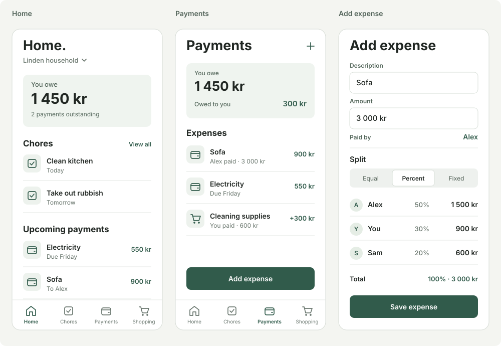
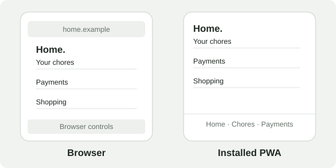
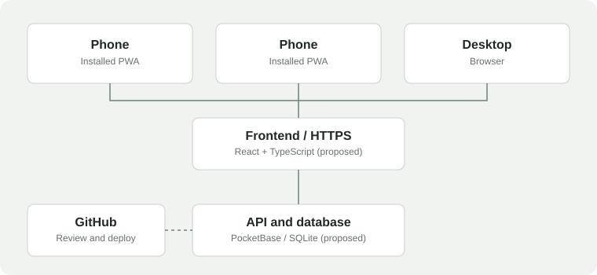

<p align="center"></p>

# Home.

A household management application for shared chores, payments and shopping, with private household spaces.

**Status:** Planning. No application code or deployment exists yet.

## Purpose

Home. gives members of any household a shared overview of what needs doing, what needs paying and what needs buying. The application should reduce everyday coordination, not create extra administrative work.

The developers share responsibility for product decisions, implementation and review. Features should solve actual household problems and be easy for every resident to use.

## Product scope

| Feature | Planned behavior |
| --- | --- |
| Home | Upcoming responsibilities and outstanding payments |
| Chores | Recurring assignments, rotation, completion and swaps |
| Payments | Rent, bills, shared purchases, flexible splits and reimbursements |
| Shopping | Shared, editable shopping list |
| Accounts | Public email registration, verification through Resend, household creation and invitations |

Calendar, buffer tracking, maintenance and move-out planning are candidates for later releases.

## Interface



*Concepts with illustrative data. Not screenshots of an implemented application.*

The design is mobile-first and deliberately restrained: meaningful headings, readable lists, consistent spacing, clear actions and minimal copy. No marketing slogans, decorative gradients or redundant labels. Accessibility and desktop usability are part of the baseline.

See [design guidelines](docs/DESIGN.md) and [product requirements](docs/PRODUCT.md).

## Technical direction

The proposed platform is a Progressive Web App (PWA), accessible in a browser or installed on a phone's home screen without an app store.





| Component | Proposal |
| --- | --- |
| Frontend | React, TypeScript, Vite |
| Backend | PocketBase |
| Database | SQLite |
| Transactional email | Resend (existing account) |
| Hosting | Self-hosted Proxmox, HTTPS |
| Collaboration | GitHub issues, branches and pull requests |
| Deployment | GitHub Actions, after approval |

These are proposals, not finalized technical decisions. See [architecture](docs/ARCHITECTURE.md) and [decision log](docs/DECISIONS.md).

## Development roadmap

1. Agree on the scope, design, stack and permissions.
2. Establish verified registration, household creation, invitations and shared UI components.
3. Implement chores, payments, shopping and dashboard.
4. Add installability, reminders and operational safeguards.
5. Test with all residents before deployment.

See the [roadmap](docs/ROADMAP.md) for the complete checklist.

## Repository guide

| Path | Contents |
| --- | --- |
| [AGENTS.md](AGENTS.md) | Instructions for AI coding agents |
| [CONTRIBUTING.md](CONTRIBUTING.md) | Branching, review and collaboration |
| [docs/](docs/) | Requirements, architecture, design, roadmap and decisions |
| [docs/design/](docs/design/) | Logo, icon and editable SVG wireframes |
| [frontend/](frontend/) | Reserved for future frontend |
| [backend/](backend/) | Reserved for future backend |
| [.github/](.github/) | Issue and pull request templates |

## Getting started

Clone the repository to review or propose changes:

```sh
git clone https://github.com/08Robfin/home.git
cd home
git switch -c docs/your-proposal
```

There are no dependencies to install or services to run at this stage. Open an issue or pull request to discuss changes.

## AI-assisted development

Coding agents must read [AGENTS.md](AGENTS.md) and the linked project documentation before making changes. AI assistance does not replace human review. Do not scaffold the application until the maintainers approve implementation.

## Privacy

Keep the repository private. Public registration does not make household data public. Never commit real household records, financial credentials, secrets or signed contracts. The application must enforce authorization on the server and support reliable backups.

## References

The documentation follows the practical structure recommended in [GitHub's README guidance](https://docs.github.com/en/repositories/managing-your-repositorys-settings-and-features/customizing-your-repository/about-readmes) and [Make a README](https://www.makeareadme.com/). Design references are collected in [docs/DESIGN.md](docs/DESIGN.md).

No public license has been selected.
