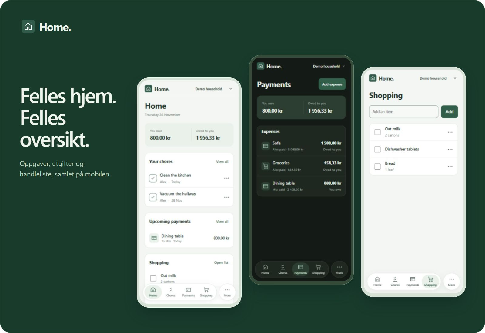
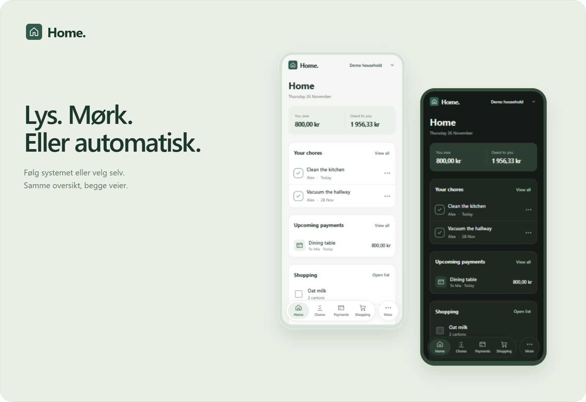
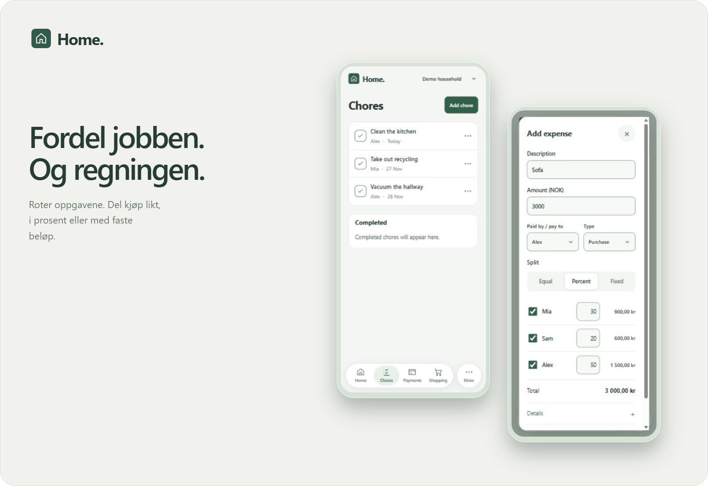
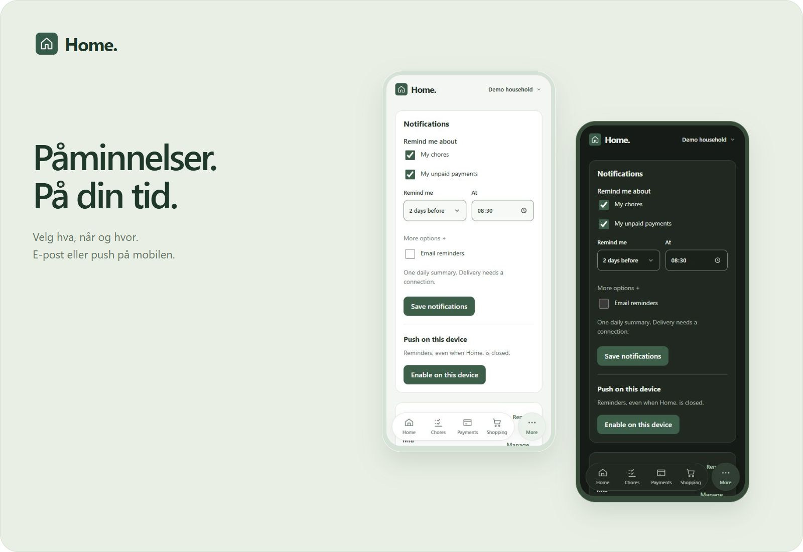

<p align="center"></p>

# Home.

A mobile-first app for shared chores, expenses and shopping. Create an account, verify your email and invite the people you live with.

[Open Home](https://home.robfin.no) · [Application source](https://github.com/08Robfin/home/tree/feat/household-app) · [Implementation PR](https://github.com/08Robfin/home/pull/1)



*Real screens from the working app, captured with a separate demo household.*

## What works

| Area | What you can do |
| --- | --- |
| Households | Create and switch households, send email invitations, manage roles and transfer ownership |
| Chores | Assign, rotate and complete chores; request a swap without cluttering the list |
| Expenses | Split purchases and recurring bills equally, by percentage or fixed amounts; attach private receipts |
| Repayments | Record partial payments and let the recipient confirm receipt |
| Shopping | Keep one shared list with quantities and checked items |
| Accounts | Verified email registration and password reset through Resend |
| Notifications | Email and per-device push, chores/payments, 0–14 days before, local time, time zone and optional overdue reminders |

The app has light, dark and system appearance, a floating mobile navigation menu and a desktop layout. Household data is private to its members. Home records repayments; it does not move money or connect to a bank.



<details>
<summary><strong>Chores, expense splitting and more screenshots</strong></summary>



[All screen captures and their provenance](docs/screenshots/README.md) · [Household switcher](docs/screenshots/mobile-households-light.jpg)

</details>

## Get started

Open [home.robfin.no](https://home.robfin.no), register and verify your email. Create a household or accept an invitation sent to the same address. Use Settings to invite residents and choose reminders. Appearance is available in More and Settings.

On iPhone, use Safari → Share → Add to Home Screen. Android and desktop browsers offer their own install option. Changes require connectivity; private records are not cached for offline access.

## Development

The working application is on `feat/household-app` while [PR #1](https://github.com/08Robfin/home/pull/1) is under review. This main page contains its current documentation and screenshot gallery.

Requires Node.js 24+. No runtime npm dependencies or frontend build step.

```sh
git clone --branch feat/household-app https://github.com/08Robfin/home.git
cd home
node backend/server.mjs
```

Open `http://localhost:3000`. Development data goes into ignored `data/home.sqlite`. Starting the web app alone does not send email.

```sh
node --test tests/*.test.mjs
```

Automated checks cover authentication, tenant isolation, invitations, exact allocations, repayments, receipts, recurrence, shopping, CSRF, reminder timing, DST, subscription isolation, encryption and delivery retries. Provider calls are mocked. A separate approved live Gmail smoke test verified delivery and link behavior; its temporary accounts and records were removed.

## Running it yourself

Node.js 24 and SQLite run in a dedicated Docker Compose project behind Nginx Proxy Manager. A separate worker sends transactional email through Resend. Only that worker mounts the sending key; credentials stay outside source control and browser code. Daily online backups include records and receipts.

See [operations and recovery](https://github.com/08Robfin/home/blob/feat/household-app/docs/OPERATIONS.md) before deploying.

## Notifications on iPhone

Add Home to your Home Screen from Safari, keep **Open as Web App** enabled if shown, and launch it from the new icon. In **Settings → Notifications**, save your schedule and tap **Enable on this device**. Push requires iOS/iPadOS 16.4+ and your permission. Use **Send test notification** after enabling it. Desktop tests cover the protocol; real iPhone delivery still needs device verification.



## Project documents

- [AI handoff and PR integration guide](docs/AI_HANDOFF.md)
- [Safari Home Screen verification](docs/SAFARI.md)
- [Product requirements](docs/PRODUCT.md)
- [Design rules and primary references](docs/DESIGN.md)
- [Architecture](https://github.com/08Robfin/home/blob/feat/household-app/docs/ARCHITECTURE.md)
- [Roadmap and remaining work](https://github.com/08Robfin/home/blob/feat/household-app/docs/ROADMAP.md)
- [Coding-agent instructions](https://github.com/08Robfin/home/blob/feat/household-app/AGENTS.md)

Account/household deletion, offline editing and furniture ownership remain future work. Original SVG concepts are retained under `docs/design` as design history. No public license has been selected.
